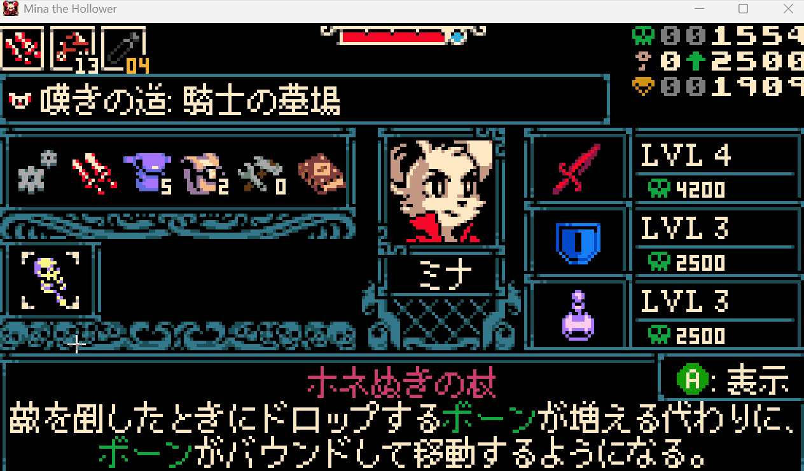

# Yabai OCR

[Português](README.md) | **English**

OCR Japanese reader for **desktop** and **Android**: select any Japanese text on screen — a manga
bubble, a subtitle, a game — and instantly see the reading, the dictionary entry and the translation,
without taking a screenshot or switching windows.

Recognition can run **online** (Google Lens) or **offline** (ML Kit on Android, PP-OCRv6 on desktop
and Android), so the app stays useful without a connection.

<p align="center">
  
</p>
<p align="center">
  <em>Running over the amazing indie game <strong>Mina the Hollower</strong> (by Yacht Club Games) — highly recommended!</em>
</p>

> **Free and non-commercial.** Yabai OCR is made for people studying Japanese — including me, who
> wrote it to read manga while learning. Use is free for any **noncommercial** purpose; selling it,
> charging for access or bundling it into a paid product is not allowed by the license. There is no
> paid version.

---

## What it does

- **Manual crop** of a screen area with immediate text recognition.
- **Full screen with a picker**: the app marks every bubble/paragraph and you tap the one you want,
  instead of getting the whole page.
- **Hover on desktop**: rest the pointer on Japanese text and the card appears with the word and its
  entry.
- **Offline dictionaries** in the Yomitan format (Jitendex, JMdict, KANJIDIC and others), with search
  by term, reading or definition, per-dictionary filter and a preferred order.
- **Furigana**: printed reading preserved, reading generated by the dictionary, or both.
- **Kanji card** with strokes, readings and compounds.
- **Offline translation** of the recognized sentence, plus a button to ask an external AI.
- **Choice of OCR engines**, with an automatic mode and a priority order.

## Platforms

| platform | requirements |
| --- | --- |
| **Windows** 10/11 | JDK 17+ to build; there is a ready package in [`apk-output/`](apk-output) for Android |
| **Linux** (X11 and Wayland/KDE) | JDK 17+; on Wayland/KDE capture uses `KWin.ScreenShot2` (the `Screenshot` portal is the fallback) and shortcuts use the `GlobalShortcuts` portal; on Plasma the hover reads the screen without a permission dialog. On GNOME (Ubuntu) the tray needs the AppIndicator extension — see [LINUX.md](docs/LINUX.md) |
| **Steam Deck** | Desktop Mode is the target; Game Mode is best effort — see [STEAMOS.md](docs/STEAMOS.md) |
| **Android** 8.0+ (API 26) | `arm64-v8a` APK; overlay and screen capture need permission |

## How to use

**Desktop**

```powershell
.\gradlew.bat :desktop:run
```

The app opens on Settings and stays in the tray. The interface exists in **Portuguese and English**,
chosen in Settings. Default shortcuts (all configurable):

| shortcut | action |
| --- | --- |
| `Ctrl + Shift + O` | full-screen capture with a segment picker |
| `Ctrl + Shift + A` | manual crop |
| `Ctrl + Shift + H` | turns hover on/off |
| `Ctrl + Shift + D` | quick dictionary lookup |
| `Ctrl + Shift + X` | cycles the hover readings |

On multi-monitor setups, Settings lets you choose which monitor the full-screen capture and the
manual crop use: the primary one, a specific monitor, or the one under the pointer when you capture.

Windows whose content does not fit the height — Settings, result, dictionary manager, quick lookup,
license and release notes — show a **scrollbar** on the right, on top of the mouse wheel.

The installed version is shown in **Settings → About**, next to the update check button; in packaged
builds it comes from the build tag (`-PyabaiVersion`), not from a fixed number. When a release is
newer, **📄 Release notes** renders the Markdown published with it, and the check on startup can be
turned off in the same card.

**Updating without a browser.** **⬇️ Download Update** fetches the package itself: on the AppImage the
running file becomes `<name>.old`, the new one takes its place and **Restart now** opens it. On
Android the APK goes through `DownloadManager` into the app's downloads folder and **stops there**:
the app neither installs it nor asks for the «install unknown apps» permission — you open the APK
whenever you want. Outside an AppImage — `gradle run`, an unpacked distribution — the desktop build
does not replace its own installation and opens the release page instead.

**Startup notice.** With «Check for updates when the app starts» on, the desktop opens a window with
the download (and the release notes) as soon as it finds a newer version, even when it started in the
tray; on Android the automatic check shows a dialog with **⬇️ Download**. The same controls stay in
the updates card afterwards.

**Android**: install the APK, grant **overlay** and **screen capture** (MediaProjection), pick an
engine and tap start. The floating bubble triggers the capture.

## OCR engines

| engine | runs on | internet | notes |
| --- | --- | --- | --- |
| **Google Lens** | desktop and Android | yes | best overall accuracy; subject to Google's usage limit |
| **ML Kit (Japanese)** | Android | no | model bundled in the APK, fast, good on printed text |
| **PP-OCRv6_manga** | desktop and Android | no | bubble detector + line reader; ~23 MB downloaded in Settings |

In **Automatic** mode the app walks the priority order you chose and only moves to the next engine
when the previous one returns no text — that is how the offline engine takes over without a
connection.

## Dictionaries

Dictionaries are local, in the [Yomitan](https://github.com/yomidevs/yomitan) format: install them
from the app's catalog or import a ZIP. Nothing you look up leaves the device.

## Building

```powershell
.\gradlew.bat :desktop:run          # runs the desktop app
.\gradlew.bat :desktop:test         # desktop suite
.\gradlew.bat :core:test            # core (pure JVM)
.\gradlew.bat :app:assembleDebug    # debug APK
.\gradlew.bat :app:testDebugUnitTest
```

Desktop packages come from `:desktop:packagePortableTarGz` and `:desktop:packageLinuxAppImage`
(Linux) or from the installer generated by Compose Desktop on Windows.

## Project structure

| module | role |
| --- | --- |
| `:core` | pure Kotlin/JVM: OCR (Lens, PP-OCRv6), protobuf, dictionaries, Japanese, geometry |
| `:desktop` | Compose Desktop: capture, picker, hover, shortcuts, tray, settings |
| `:app` | Android: capture service, overlays, dictionaries, translation |

The detailed map — file by file, flows and pitfalls — is in [ARCHITECTURE.en.md](ARCHITECTURE.en.md).

## Documentation

| document | content |
| --- | --- |
| [ARCHITECTURE.en.md](ARCHITECTURE.en.md) | full code structure, flows and where to change things |
| [ROADMAP.md](docs/ROADMAP.md) | technical history of every change (in Portuguese) |
| [LANGUAGES.md](LANGUAGES.md) | interface texts in Portuguese and English |
| [LINUX.md](docs/LINUX.md) | Linux support (X11, Wayland, portals) |
| [STEAMOS.md](docs/STEAMOS.md) | installing and using it on the Steam Deck |
| [AGENTS.md](AGENTS.md) | working conventions in this repository |
| [CONTRIBUTING.en.md](CONTRIBUTING.en.md) | how to build, test and send a change |

## Suggestions and Support

I am always open to suggestions and feedback! Because this is a learning project, many features have
not been tested extensively and may not work 100% as expected. Your feedback while testing the app
is extremely important in helping me find and fix problems.

If you have ideas for improvements or want to report a bug, open an *issue* — if the idea involves
code, read [CONTRIBUTING.en.md](CONTRIBUTING.en.md) first.

If you find this project useful and want to support its development financially, you can donate
through:

- ☕ **Ko-fi:** [ko-fi.com/yabaihonyaku](https://ko-fi.com/yabaihonyaku)
- 💸 **Pix (Brazil):** `yabaihonyaku@gmail.com`

<p align="center">
  
</p>

Donate only if it is possible for you: the app stays free and complete for everyone, and no donation
gives access to anything exclusive.

## Status and contributions

The project is under active development. Bugs and suggestions are welcome through *issues*; before
opening a *pull request*, read [AGENTS.md](AGENTS.md) — the regression test and mutation proof rules
apply to any behavior change.

## License

[PolyForm Noncommercial 1.0.0](LICENSE): use, copy, modify and redistribute freely for any
**noncommercial** purpose — study, personal use, hobby projects, research, schools and other
nonprofit organizations. **Selling it, charging for access or bundling it into a paid product is not
allowed**; commercial use needs a separate license from the author. The software is provided
without warranty.

The project is **free and non-commercial**: it exists to help people study Japanese. The full
license text is in [LICENSE](LICENSE).
