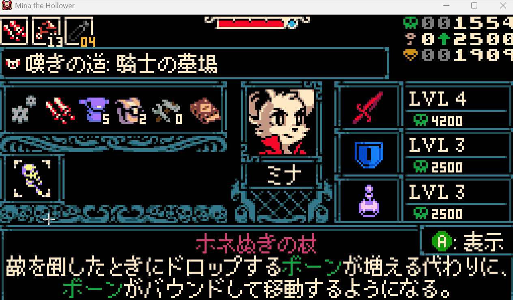

# Yabai OCR

**Português** | [English](README.md)

Leitor de japonês com OCR para **desktop** e **Android**: selecione qualquer texto japonês na tela —
um balão de mangá, uma legenda, um jogo — e veja na hora a leitura, o significado no dicionário e a
tradução, sem tirar print nem abrir outra janela.

O reconhecimento pode ser **online** (Google Lens) ou **offline** (ML Kit no Android, PP-OCRv6 no
desktop e no Android), então o app continua útil sem conexão.

<p align="center">
  
</p>
<p align="center">
  <em>Exemplo rodando sobre o excelente jogo indie <strong>Mina the Hollower</strong> (da Yacht Club Games) — altamente recomendado!</em>
</p>

> **Gratuito e sem fins lucrativos.** O Yabai OCR é feito para quem estuda japonês — inclusive eu, que
> escrevi o app para ler mangá enquanto estudo. O uso é livre para qualquer finalidade **não
> comercial**; vender, cobrar pelo acesso ou embutir o app num produto pago não é permitido pela
> licença. Não há versão paga.

---

## O que ele faz

- **Recorte à mão** de uma área da tela e leitura imediata do texto.
- **Tela inteira com seletor**: o app marca cada balão/parágrafo e você toca no que quer ler, em vez
  de receber a página toda.
- **Hover no desktop**: pare o mouse sobre um texto japonês e o cartão aparece com a palavra e o
  verbete. Com um dicionário escolhido, é dele que vem a resposta; quando ele não tem o verbete o app
  avisa, em vez de trocar de dicionário sozinho.
- **Dicionários offline** no formato do Yomitan (Jitendex, JMdict, KANJIDIC e outros), com busca por
  termo, leitura ou definição, filtro por dicionário e ordem de preferência.
- **Furigana**: leitura impressa preservada, leitura gerada pelo dicionário, ou as duas.
- **Card de kanji** com traços, leituras e compostos.
- **Tradução offline** da frase reconhecida e botão para perguntar a uma IA externa.
- **Motores de OCR à escolha**, com modo automático e ordem de prioridade.

## Requisitos

Os pacotes do desktop trazem o runtime JDK 21 embutido e escrevem só em `$HOME`: não precisa de
root, nada vai para `/usr` e não é preciso instalar Java.

| sistema | requisitos |
| --- | --- |
| **SteamOS / Steam Deck** | Desktop Mode (KDE Plasma, Wayland). Game Mode é melhor esforço — ali não há hover nem atalhos globais. FUSE 2 (`libfuse.so.2`) só é necessário para o `.AppImage`; o `.tar.gz` não precisa de nada |
| **Ubuntu 22.04+ / Debian 12+** | Wayland (GNOME ou KDE) ou X11. FUSE 2 para o AppImage: `libfuse2` até o 22.04, `libfuse2t64` no 24.04+. No GNOME a bandeja precisa de `gnome-shell-extension-appindicator` e a captura de `xdg-desktop-portal-gnome` |
| **Outro Linux x86_64** | glibc 2.31+, `xdg-desktop-portal` com o backend (`-kde` ou `-gnome`) e fonte japonesa (`fc-list :lang=ja`) |
| **Windows** 10/11 | o `.exe`/`.msi` do release; nada além disso |
| **Android** 8.0+ (API 26) | APK `arm64-v8a`; permissões de sobreposição e de captura concedidas no app |

Compilar do código exige JDK 17+ e o wrapper do Gradle — ver [Compilar](#compilar).

## Instalação

> **Baixe os arquivos da versão mais recente para o seu sistema na página de [Releases no GitHub](https://github.com/SorrisoKDente/YabaiOCR/releases/latest).**

### SteamOS / Steam Deck (Desktop Mode)

```bash
mkdir -p ~/Applications
mv ~/Downloads/Yabai_OCR*.AppImage ~/Applications/
chmod +x ~/Applications/Yabai_OCR*.AppImage
~/Applications/Yabai_OCR*.AppImage
```

O app abre nos Ajustes e fica na bandeja. **Ajustes → Integrar ao sistema** coloca no menu de
aplicativos, aponta a entrada para o AppImage em execução e atualiza o índice do menu (nada é escrito
fora de `$HOME`); **Iniciar na bandeja ao entrar na sessão** liga o autostart. Sem FUSE na máquina? Rode o AppImage com `--appimage-extract-and-run`, ou use o `.tar.gz`
(`tar -xzf … -C ~/Applications/yabai-ocr`) ou o `.deb`. Guia completo:
[STEAMOS.md](docs/STEAMOS.md).

**Reinicie a sessão uma vez depois de instalar, se ligar Ajustes → 🖼 Captura silenciosa no KDE.** O
KWin recusa a interface de captura a um programa que roda de `/tmp/.mount_*`, que é exatamente o caso
de um AppImage: sem essa opção, todo hover abre o diálogo de permissão do portal. Ela grava
`~/.config/environment.d/yabai-ocr.conf` e **a sessão só lê esse arquivo no login** — um sair e entrar,
uma vez, e não a cada abertura do app. Atalhos, bandeja, hover e captura pelo portal já funcionam
assim que o app abre; só a captura sem diálogo espera o relogin.

### Ubuntu e Debian

```bash
# AppImage
sudo apt install libfuse2t64     # Ubuntu 24.04+; use libfuse2 no 22.04 e anteriores
chmod +x ~/Downloads/Yabai_OCR*.AppImage
mv ~/Downloads/Yabai_OCR*.AppImage ~/Applications/
~/Applications/Yabai_OCR*.AppImage

# ou o .deb
sudo apt install ./yabai-ocr_<versão>_amd64.deb
```

**No GNOME Wayland, saia e entre na sessão depois da primeira abertura.** O ponteiro do hover vem de
uma extensão do Shell que o app instala e ativa sozinho, e o GNOME só carrega extensões no início da
sessão; até esse relogin o app mostra o hover como indisponível em vez de funcionar pela metade. A
bandeja precisa de `gnome-shell-extension-appindicator`. No **KDE Plasma** (Kubuntu) o reinício da
sessão só é necessário para a captura silenciosa, igual ao SteamOS. Detalhes de captura e checklist de
aceite estão em [LINUX.md](docs/LINUX.md).

### Windows

Rode o `.exe`/`.msi` do release. O SmartScreen do Windows pode avisar sobre instalador sem assinatura
— «Mais informações → Executar assim mesmo». O instalador embute o runtime; não há pré-requisito de
Java.

### Android

Instale o APK `arm64-v8a` (permita «instalar apps desconhecidos» para o gerenciador de arquivos),
conceda **sobreposição** e **captura de tela** quando o app pedir, escolha o motor de OCR e toque em
iniciar. A bolha flutuante dispara a captura.

## Como usar

**Desktop**

```powershell
.\gradlew.bat :desktop:run
```

O app abre nos Ajustes e fica na bandeja. O ícone da bandeja mostra o estado do hover de relance: um
ponto verde significa ligado; um ponto vermelho com um traço branco significa desligado. A interface
existe em **português e inglês**, escolhido nos Ajustes. Atalhos padrão (todos configuráveis):

| atalho | ação |
| --- | --- |
| `Ctrl + Shift + O` | captura de tela inteira com seletor de trechos |
| `Ctrl + Shift + A` | recorte à mão |
| `Ctrl + Shift + H` | liga/desliga o hover |
| `Ctrl + Shift + D` | busca rápida no dicionário |
| `Ctrl + Shift + X` | alterna entre as leituras do hover |

Em telas múltiplas, os Ajustes deixam escolher qual monitor a captura de tela inteira e o recorte à
mão usam: o principal, um monitor específico ou aquele em que o ponteiro está no momento da captura.

As janelas cujo conteúdo não cabe na altura — Ajustes, resultado, gerenciador de dicionários, busca
rápida, licença e notas da versão — mostram **barra de rolagem** à direita, além da roda do mouse.

A versão instalada aparece em **Ajustes → Sobre**, junto do botão de verificação de atualizações; nos
pacotes ela vem da tag do build (`-PyabaiVersion`), não de um número fixo. Quando há versão nova, o
botão «📄 Notas da versão» abre o Markdown publicado no release do GitHub, e a checagem ao abrir o app
pode ser desligada no mesmo cartão.

**Atualizar sem navegador.** «⬇️ Baixar Atualização» baixa o próprio pacote: no AppImage o arquivo em
execução vira `<nome>.old`, o novo toma o lugar e «Reiniciar agora» abre a versão nova. No Android o
APK é baixado pelo `DownloadManager` para a pasta de downloads do app e **para aí**: o app não
instala nem pede a permissão «instalar apps desconhecidos» — você abre o APK quando quiser. Fora do
AppImage — `gradle run`, distribuição descompactada — o desktop não substitui a instalação sozinho e
abre a página do release.

**Aviso de atualização.** Com «Verificar atualizações ao abrir o aplicativo» ligado, o desktop abre uma
janela com o download (e as notas) assim que encontra uma versão nova, mesmo iniciando na bandeja; no
Android a checagem automática mostra um diálogo com «⬇️ Baixar». Depois disso os mesmos controles
continuam no cartão de atualizações.

**Atualização de dicionário usa a mesma janela.** A checagem automática de dicionários (desativada,
diária, semanal ou mensal nos Ajustes) roda também com o app só na bandeja: o aviso lista cada
dicionário com a revisão instalada e a nova, e um botão «Atualizar dicionários». A mesma janela carrega
a versão do app quando as duas existem, porque a atualização do app termina em reinício — que
interromperia o download de um dicionário; cada uma é avisada uma vez por revisão remota, então uma
atualização ignorada não volta a aparecer.

**Android**: instale o APK, conceda **sobreposição** e **captura de tela** (MediaProjection), escolha
o motor e toque em iniciar. A bolha flutuante dispara a captura.

## Motores de OCR

| motor | onde roda | internet | observações |
| --- | --- | --- | --- |
| **Google Lens** | desktop e Android | sim | melhor precisão geral; sujeito a limite de uso do Google |
| **ML Kit (japonês)** | Android | não | modelo embutido no APK, rápido, bom em texto impresso |
| **PP-OCRv6_manga** | desktop e Android | não | detector de balões + leitor de linhas; ~23 MB baixados nos Ajustes |

No modo **Automático** o app percorre a ordem de prioridade escolhida e só passa para o próximo motor
quando o anterior não devolve texto — é assim que o offline assume quando não há conexão.


## Renderizador gráfico

O app de desktop desenha as janelas com Skiko. No Windows o renderizador padrão é o Direct3D, que em
alguns drivers fecha o app sem nenhum erro. Em Ajustes → **Renderizador gráfico** dá para escolher
outro: **Automático** (o padrão do sistema), **OpenGL** (continua usando a placa de vídeo e evita o
Direct3D) ou **Software** (CPU, o mais lento e o mais estável). A escolha vale na próxima abertura do
app. As mesmas opções existem na linha de comando, para quando o app empacotado é difícil de configurar:

```
yabai-ocr --renderer=opengl      # ou --renderer=software / --renderer=automatic
```

Se uma execução for fechada por esse crash, a seguinte sai sozinha um passo do Direct3D — OpenGL
primeiro, software só se esse também cair — e avisa no log. Nada é definitivo: escolha Automático nos
Ajustes para voltar.

## Dicionários

Os dicionários são locais, no formato do [Yomitan](https://github.com/yomidevs/yomitan): instale pelo
catálogo do app ou importe um ZIP. Nada do que você pesquisa sai do aparelho.

## Compilar

```powershell
.\gradlew.bat :desktop:run          # roda o desktop
.\gradlew.bat :desktop:test         # suíte do desktop
.\gradlew.bat :core:test            # núcleo (JVM puro)
.\gradlew.bat :app:assembleDebug    # APK de debug
.\gradlew.bat :app:testDebugUnitTest
```

Os pacotes do desktop saem de `:desktop:packagePortableTarGz` e `:desktop:packageLinuxAppImage`
(Linux) ou do instalador gerado pelo Compose Desktop no Windows. No Linux/macOS é o mesmo comando
com `./gradlew`:

```bash
./gradlew :desktop:run                     # roda o desktop
./gradlew :desktop:test                    # suíte do desktop
./gradlew :desktop:packagePortableTarGz    # .tar.gz portátil
APPIMAGETOOL=~/appimagetool ./gradlew :desktop:packageLinuxAppImage   # .AppImage de arquivo único
```

Se `./gradlew` responder `required file not found` ou `$'\r': command not found`, o checkout veio
com CRLF: `git checkout -- gradlew desktop/package/linux/build-appimage.sh` resolve (o
`.gitattributes` do repositório mantém os dois em LF daqui para frente).

## Estrutura do projeto

| módulo | papel |
| --- | --- |
| `:core` | Kotlin/JVM puro: OCR (Lens, PP-OCRv6), protobuf, dicionários, japonês, geometria |
| `:desktop` | Compose Desktop: captura, seletor, hover, atalhos, bandeja, ajustes |
| `:app` | Android: serviço de captura, overlays, dicionários, tradução |

O mapa detalhado — arquivo por arquivo, fluxos e armadilhas — está em
[ARCHITECTURE.md](ARCHITECTURE.md).

## Documentação

| documento | conteúdo |
| --- | --- |
| [ARCHITECTURE.md](ARCHITECTURE.md) | estrutura completa do código, fluxos e onde mexer |
| [ROADMAP.md](docs/ROADMAP.md) | histórico técnico: causa raiz, correção e evidências de cada mudança |
| [LANGUAGES.md](LANGUAGES.md) | textos de interface em português e inglês |
| [LINUX.md](docs/LINUX.md) | suporte a Linux (X11, Wayland, portais) |
| [STEAMOS.md](docs/STEAMOS.md) | instalação e uso no Steam Deck |
| [AGENTS.md](AGENTS.md) | convenções de trabalho no repositório |
| [CONTRIBUTING.md](CONTRIBUTING.md) | como compilar, testar e enviar uma mudança |

Os documentos públicos existem em inglês e em português (`README.md`, `README.pt-BR.md`,
`ARCHITECTURE.en.md`, `CONTRIBUTING.md`); o `docs/ROADMAP.md` é o histórico técnico interno, em português.

## Sugestões e Suporte

Estou sempre aberto a sugestões e feedback! Por ser um projeto de aprendizado, muitas
funcionalidades ainda não foram testadas extensivamente e podem não funcionar 100% como esperado. O
seu feedback ao testar o app é extremamente importante para me ajudar a identificar e corrigir
problemas.

Se você tiver ideias de melhorias ou quiser reportar um erro, abra uma *issue* — se a ideia for
enviar código, leia antes o [CONTRIBUTING.md](CONTRIBUTING.md).

Se você achar este projeto útil e quiser apoiar financeiramente o seu desenvolvimento, você pode
doar através de:

- ☕ **Ko-fi:** [ko-fi.com/yabaihonyaku](https://ko-fi.com/yabaihonyaku)
- 💸 **Pix (Brasil):** `yabaihonyaku@gmail.com`

<p align="center">
  
</p>

Doe apenas se for possível para você: o app continua gratuito e completo para todo mundo, e nenhuma
doação dá acesso a algo exclusivo.

## Estado e contribuições

O projeto está em desenvolvimento ativo. Bugs e sugestões são bem-vindos pelas *issues*; antes de
abrir um *pull request*, leia [AGENTS.md](AGENTS.md) — as regras de teste de regressão e de prova de
mutação valem para qualquer mudança de comportamento.

## Licença

[PolyForm Noncommercial 1.0.0](LICENSE): use, copie, modifique e redistribua livremente para
**qualquer finalidade não comercial** — estudo, uso pessoal, projetos de hobby, pesquisa, escolas e
outras organizações sem fins lucrativos. **Vender, cobrar pelo acesso ou embutir o app num produto
pago não é permitido**; para uso comercial é preciso uma licença separada, pedida ao autor. O
software é fornecido sem garantias.

O projeto é **gratuito e sem fins lucrativos**: existe para ajudar quem estuda japonês. O texto
completo da licença está no [LICENSE](LICENSE).
